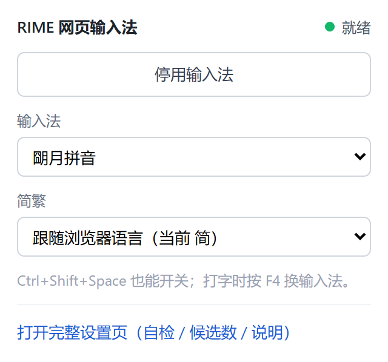

# CHANGELOG

把 [LibreService/my_rime](https://github.com/LibreService/my_rime)（把 librime 编译成 WebAssembly
的在线输入法 PWA）改造成**浏览器扩展形态的输入法**：在任意网页的输入框里直接用 RIME 打字，
不用切标签页、不用复制粘贴。**一套源码出 Chrome / Firefox 两个包，整个项目零构建。**

本文档只记录**已经做完并验证过的事**。还没做的、没验的，全部在 [`TODO.md`](TODO.md)。

> 说明：项目早期没有逐次留 changelog，所以最初的三个版本（0.1.0 主体实现，以及
> 「e2e 重跑 + 全方案覆盖」「重新打包」两次收尾）按**主题**记录，只有 2026-10-01 之后
> 的那几段带日期。补不回来的历史不做编造。

---

## 目录结构（备忘）

```
E:\项目文件\DSH\RIME_chrome\
├── README.md                    仓库总览（给人看的入口）
├── CHANGELOG.md                 本文档：做过什么
├── TODO.md                      还没做什么 / 还没验什么
├── LICENSE                      AGPL-3.0 全文
├── reference\
│   └── my_rime\                 上游仓库完整克隆，只读参考
│                                git status 应为 0 改动；停在 c73ea17 "0.10.9: emscripten 3.1.63"
├── .tools\
│   ├── chrome-for-testing\      Chrome for Testing 154.0.8037.92（约 600 MB）
│   │                            刻意放在扩展目录**外面**，见「环境陷阱」
│   ├── firefox\                 Firefox Nightly（e2e-firefox.mjs 用）
│   ├── geckodriver\             WebDriver 前端，只作前端，不负责启动浏览器
│   └── fetch-firefox.mjs        下载上面两个
└── rime-browser-ime\            我们的项目 = 扩展根目录
    ├── manifest.json            MV3 清单（Chrome 用；Firefox 那份构建期生成）
    ├── README.md                项目文档：安装/使用/验证/踩坑
    ├── docs\ARCHITECTURE.md     设计取舍与实现细节（**先读这个**）
    ├── icons\  licenses\
    ├── schemas\                 预编译输入方案，当前 42 个文件 / 32.1 MB
    │   ├── manifest.json        由 fetch-assets.mjs 生成的文件清单
    │   └── luna-pinyin\ stroke\ double-pinyin\ pinyin-simp\ wubi\ terra-pinyin\ bopomofo\
    ├── src\
    │   ├── common\const.js      消息类型 + 15 个输入方案注册表 + 简繁（content 与扩展页面共用）
    │   ├── background\service-worker.js   路由 + 开关 + offscreen 生命周期
    │   ├── background\engine-bridge.js    **唯一的平台分叉点**（offscreen / 背景页宿主）
    │   ├── engine\host.js       引擎宿主本体（平台无关，顶层无副作用）
    │   ├── engine\{worker.js,rime.js,rime.wasm,rime.data}   worker.js 是我们的，其余 vendored
    │   ├── offscreen\{offscreen.html,offscreen.js}   引擎宿主（Chrome 路径）
    │   ├── content\{caret,candidate-window,ime,bootstrap,status-bar}.js
    │   │                        按键接管/光标定位/候选窗/上屏/右下角状态栏
    │   ├── options\{options.html,options.js}   设置页（含使用说明、自检）
    │   ├── popup\{popup.html,popup.js}         工具栏小面板（开关 / 方案 / 简繁）
    │   └── playground\{playground.html,playground.js}   自带测试页
    ├── scripts\                 开发脚本，不参与扩展运行时
    │   ├── check.mjs            静态自检（当前 184 项）
    │   ├── engine-smoke.mjs     引擎全链路（27 项）
    │   ├── content-smoke.mjs    content 逻辑（73 项）
    │   ├── ipc-smoke.mjs        IPC 全链路（21 项，`--platform=chrome|firefox`）
    │   ├── e2e-test.mjs         真实 Chrome 端到端（可用 EXT_ROOT 指向打包产物）
    │   ├── e2e-firefox.mjs     真实 Firefox 端到端（geckodriver + WebDriver，零依赖）
    │   ├── fetch-assets.mjs     拉取引擎 + 方案
    │   ├── make-icons.mjs       生成图标
    │   ├── pack-crx.mjs         打包成可安装的 crx + zip + 解压目录（**主打包入口**）
    │   ├── build-firefox.mjs    产出 Firefox 的免解压目录 + zip
    │   ├── package.mjs          只产出可分发的 zip
    │   ├── verify-crx.mjs       独立校验 crx 的结构与签名
    │   └── lib\
    │       ├── zip.mjs          最小 ZIP 写入器（打包脚本共用）
    │       ├── files.mjs        三个打包脚本共用的文件收集
    │       └── manifest.mjs     Chrome 清单 → Firefox 清单（构建与 check.mjs 共用）
    ├── rime-browser-ime.pem     签名私钥（决定扩展 id；已 gitignore，别提交/外传）
    └── dist\                    crx + zip + unpacked + firefox（见「打包」一节）
```

上面是**开发工作区**的全貌。**入库的只有 `rime-browser-ime/` 与三份根文档**，
`reference/`（上游克隆）和 `.tools/`（约 1.1 GB 的浏览器）由根 `.gitignore` 排除 ——
上游地址：<https://github.com/LibreService/my_rime>。
`dist/`、`.cache/`、`.tmp/`、`*.pem`、`*.log` 由 `rime-browser-ime/.gitignore` 排除。

---

## 未标日期的三段（0.1.0 主体 + 两次收尾）

### 主体实现（0.1.0）

改造路线一句话：**不重编 wasm**，直接消费上游发布在 npm 上的预编译产物；引擎放进
offscreen document + Web Worker 长期常驻；content script 负责接管按键、跟随光标画候选窗、
把结果注入页面。

- 上游 `@rime-contrib/*` 包里已经是**用原生 `rime_api_console` 部署好的**
  `.table.bin` / `.prism.bin` / `.schema.yaml`，写进 `/usr/share/rime-data/build/`
  再 `set_ime(id)` 即可，**完全跳过部署**。代价是不能热改方案，所以协议里**刻意没有 `deploy`**。
- 分层理由（详见 `docs/ARCHITECTURE.md`）：不放 content script（页面 CSP 会挡住 wasm 编译，
  且每标签页都要重编 2.8 MB）；不放 service worker（MV3 的 SW 空闲约 30 秒被回收，
  重建引擎会让第一次按键明显卡顿）；必须经过 SW（`chrome.offscreen` 只能由 SW 调用）。
- 内置 15 个输入方案、4 个分组（音码 / 双拼 / 注音 / 形码）。

### e2e 重跑 + 全方案覆盖

`scripts/e2e-test.mjs` 多跑两段：

1. **切换方案（精确断言）** —— 特意挑两个「同一按键串映射到不同结果」的方案：
   自然码双拼 `vuhk` → 煮好，小鹤双拼 `vuhk` → 住坏 / 住壞。若切换只改状态、引擎没真换，
   第二条会退回「煮好」而被抓出来；再切回朙月拼音验证来回切。
   （原先用 `nihk` → 你好 / 你坏，加了简繁功能后两个方案都出「你好」，区分度消失，故换掉。）
2. **全部 15 个方案遍历** —— 每个方案用「输入串 + 该方案认的确认键 → 确切上屏文本」断言。
   期望值来自离线实测（同一份 wasm + 同一批预编译方案），所以这一层实际检查的是
   **浏览器侧那一环**：`schemas/manifest.json` 映射、offscreen 读文件路径、
   跨进程传 ArrayBuffer 有没有把词典弄坏。

最终输出：

```
== 切换输入方案 ==
✅ double_pinyin：组字中 -> vuhk + 空格 -> 煮好
✅ double_pinyin_flypy：组字中 -> vuhk + 空格 -> 住坏
✅ 切回 luna_pinyin：nihao + 空格 -> 你好

== 全部方案遍历（15 个）==
  ✓ luna_pinyin            nihao   -> 你好
  ✓ luna_pinyin_fluency    nihao   -> 你好
  ✓ pinyin_simp            nh      -> 你好
  ✓ terra_pinyin           nihao   -> 你好
  ✓ double_pinyin          nihk    -> 你好
  ✓ double_pinyin_flypy    nihk    -> 你坏
  ✓ double_pinyin_mspy     nihk    -> 你好
  ✓ double_pinyin_abc      nihk    -> 你好
  ✓ double_pinyin_pyjj     nihao   -> 你哈哦
  ✓ bopomofo               su3cl3  -> 你好
  ✓ bopomofo_express       su3cl3  -> 你好
  ✓ wubi86                 wqiy    -> 你
  ✓ wubi_pinyin            nihao   -> 你好
  ✓ wubi_trad              nihao   -> 你好
  ✓ stroke                 hpsh    -> 紅皮書
  小计：15/15 个方案在真实浏览器里装载 + 打字上屏成功
```

（上面是**简体**环境的输出。若在 zh-TW / zh-Hant 环境跑，小鹤那两行会是「你壞」/「住壞」；
`checkAllSchemas` 与切换方案两处都会跟随语言自动换期望。）

#### 写这条用例时挖出来的两个真实缺陷（都已修）

**缺陷 1：切换输入法根本切不动。** `src/content/ime.js` 的 `request()` 原本是

```js
payload: { ...payload, schemaId: this.schemaId }   // 无条件覆盖
```

而 `switchSchema()` 传的是 `{ schemaId: 新方案 }`、此刻 `this.schemaId` 还是旧的，
于是新值被旧值顶掉 —— `LOAD_SCHEMA` 实际收到的永远是旧方案，`ensureSchema()` 判定
「已经就是这个方案」直接返回缓存，**引擎压根没换**。表现是「下拉框 / F4 看起来切了，
打字还是老方案」。

修法：`payload` 里显式给了 `schemaId` 就以它为准，只在没给时才回退到 `this.schemaId`。

**缺陷 2：`setSettings()` 提前改 `this.schemaId`。** 它原本先赋值再 `reset()`，
**没有 await**，所以在引擎装载完成之前，后续按键就会带着新方案名发给一个还在用旧方案的引擎。
现在改成 `enqueue(() => this.switchSchema(...))`，让它和按键串行、且只在装载成功后才更新状态。

> 这两个 bug 是**离线断言全绿也照样存在**的 —— 因为 content-smoke 里 `switchSchema`
> 被桩掉了。e2e 是唯一能发现它们的层。

#### 顺带记录：确认键各方案不同（不是 bug）

写遍历用例时踩到的，别误判成缺陷：

- 空格在多数方案上确认首候选，但在 **语句流 / 注音 / 注音·快打** 上只翻页不确认；
- **自然码双拼的回车是「原样上屏编码」**（所以那个方案要换输入串，不能用回车断言）；
- `double_pinyin_pyjj` 的 `nihao` + 空格得到**「你哈哦」**（逐字），不是整句「你好」。

所以断言表里每个方案的确认键是分别实测选的，不能统一。

### 重新打包

先用 `node scripts/package.mjs`（当时唯一打包入口）重跑，后来主入口换成 `pack-crx.mjs`，
`dist/` 变成 crx + zip + unpacked 三样。**2026-10-02 加完工具栏面板后又打过一次**
（`node scripts/pack-crx.mjs` + `verify-crx.mjs`）：

```
打包完成：
  dist/rime-browser-ime-0.1.0.crx            16.52 MB   ← 可安装
  dist/rime-browser-ime-0.1.0.zip            16.52 MB
  dist/rime-browser-ime-0.1.0-unpacked/      36.27 MB
  扩展 id     = gnnmiafmbhofbbpgpipgmalekdekceki
  文件数      = 70   原始 36.27 MB -> 压缩后 16.52 MB
```

---

## 2026-09-30

### 文档数字与许可描述校正

- `rime-browser-ime/README.md` 验证表改为 `75 / 18 / 45 / 17`（`check.mjs` 后来随功能增长到 184）。
- 「当前内置方案：朙月拼音」改成 15 个方案的分组表格；体积改为实测值。
- 根 `README.md` 验证表同步，并新增一行「当前内置方案」。
- 许可描述列全：原来只提朙月拼音和五笔画，现在补上双拼 GPL-3.0-only、
  袖珍简拼 Apache-2.0、粤语 CC-BY-4.0。

> 当时**临时标注过两处「未验证」**（README 里「除朙月拼音外其余 14 个方案尚未真机验证」、
> e2e 输出样例标注为旧方案下的结果）。全方案遍历做完后**已改成实测通过的状态**，
> 因为缺口真的补上了 —— **不要再把「未验证」的旧说法改回去**。

### 设置页的输入法下拉框分组

`src/options/options.js` 现在按 `SCHEMAS` 的 `group` 字段生成 `<optgroup>`，
分组为 音码 / 双拼 / 注音 / 形码。顺带三处改进：

- 切换方案时把 `<select>` 置灰、引擎状态文字改成「正在装载…」；
- 加 `switching` 标志：切换期间暂停那个 1.5 秒一次的 `refresh()` 轮询，
  否则轮询会把「正在装载…」立刻覆盖掉；
- 切换失败时回滚到**上一次后台确认生效的方案**（`committedSchemaId`），
  而不是回滚到 `select.value` —— 那时 `select` 里已经是新方案了，回滚等于没做。

### 补一处切换反馈

`src/content/ime.js` 新增 `showSwitchNotice(schemaId)`：切换成功后用
`this.window.showMessage()` 弹一条「已切换到 小鹤双拼」，1.5 秒后 `this.window.hide()`。
定时器里判断了 `this.composing` —— 这 1.5 秒内用户可能已经开始打字，
不能把正在显示的候选窗一起收掉。F4 循环切换时这个反馈尤其有用。

### 打出「可安装」的扩展包（CRX3）

原来 `dist/` 里只有 zip：装的时候得手动解压、再去 `chrome://extensions` 开开发者模式、
点「加载已解压的扩展程序」。这不叫「安装一个插件」。现在有了签名的 CRX3。

**新增文件**

- `scripts/pack-crx.mjs` —— 主打包入口，一次产出三样：
  - `dist/rime-browser-ime-0.1.0.crx`  可安装（签名过，固定扩展 id）
  - `dist/rime-browser-ime-0.1.0.zip`  分发用
  - `dist/rime-browser-ime-0.1.0-unpacked/`  免解压，直接选目录
- `scripts/verify-crx.mjs` —— 独立校验 crx（从零解析，**故意不复用** pack-crx 的函数，
  否则同一个 bug 会在生成和校验里同时成立）
- `scripts/lib/zip.mjs` —— 把原来 `package.mjs` 里的 ZIP 写入器抽出来共用
- `rime-browser-ime.pem` —— RSA-2048 签名私钥，**扩展 id 由它决定**

**为什么手写 CRX3 而不用 Chrome 自带的 `--pack-extension`**

实测那个开关在受限沙箱里起不来：`crashpad ... OpenProcess: 拒绝访问`，Chrome 直接自杀
（和「环境陷阱」记录的是同一个坑）；而且当前这版 Chrome for Testing 上
`--pack-extension` 已经**不再产出任何文件**了。这个项目本来就没有任何外部依赖，
所以按 Chromium 源码手写。

**正确的 CRX3 格式**（照 `components/crx_file/crx3.proto` 与 `crx_verifier.cc`
逐行核对过，**别再凭记忆改**）：

```
[4 字节] "Cr24" | [4 字节] 版本=3 | [4 字节] 头长度 N | [N 字节] CrxFileHeader | ZIP 载荷

message CrxFileHeader {
  repeated AsymmetricKeyProof sha256_with_rsa = 2;   // ← 公钥和签名在这个子消息里！
  repeated AsymmetricKeyProof sha256_with_ecdsa = 3;
  optional bytes signed_header_data = 10000;          // 内容是个 SignedData，18 字节
}
message AsymmetricKeyProof { optional bytes public_key = 1; optional bytes signature = 2; }
message SignedData { optional bytes crx_id = 1; }     // 恰好 16 字节，**没有算法字段**

签名（RSA_PKCS1_SHA256）覆盖：
  "CRX3 SignedData\0"                 ← kSignatureContext（crx_file.h），含结尾 0 字节
+ u32le(len(signed_header_data))      ← 「[signed-header-size]」，**最容易漏掉的一段**
+ signed_header_data
+ 整段 ZIP 载荷
```

> **踩坑记录（第一版就是错的）**：最初凭理解写成了「顶层 field 2 = 公钥、自造一个算法字段、
> 签名放 field 10001、签名串不含长度前缀」。结果 Chrome 报 **`包无效:"CRX_HEADER_INVALID"`**。
> 更糟的是 `verify-crx.mjs` 当时复用了同一套错误假设，所以**校验也是"通过"的** ——
> 生成端和校验端一起错，等于自我确认。
> 教训：写二进制格式要么照规范逐字实现，**要么**让校验端的假设来源与生成端相互独立。
> 现在 `verify-crx.mjs` 里还加了一条**反证断言**：去掉长度前缀后签名必须验不过，
> 用来防止「前缀没进签名」这类静默错误再次发生。

**扩展 id**

```
扩展 id = SHA256(SPKI DER) 前 16 字节，逐半字节映射到 a–p
        = gnnmiafmbhofbbpgpipgmalekdekceki
```

因为 id 由私钥决定，**`rime-browser-ime.pem` 弄丢 = 换一个扩展 id = 只能卸载重装**。
它被 `.gitignore`（`*.pem`）覆盖，不会进仓库。更新版本时复用同一把钥即可覆盖升级。

> 注意：**「加载已解压」和「装 crx」的扩展 id 现在是一致的**。打包时 `pack-crx.mjs`
> 会往产物的 `manifest.json` 里注入一个 `key` 字段（DER SPKI 的 base64，由签名私钥导出），
> Chrome 就会用这把公钥算 id。不注入的话，Chrome 对未打包扩展是按目录路径算 id
> （`id_util::GenerateIdForPath`），两者会不一致。
> 源目录的 `manifest.json` 保持干净，只有产物里那份带 `key`。
> （实测：`EXT_ROOT=dist/…-unpacked` 加载，id 报的就是 `gnnmiaf…`，与 crx 相同。）

**验证做到哪一步**

1. `node scripts/verify-crx.mjs` —— 容器头、protobuf 字段结构、RSA 签名、id 推导、
   头里不含 ZIP EOCD token、`header_size` 恰好覆盖全部头字段、产物 manifest 的 `key`
   与 crx 公钥推出同一个 id、载荷 zip 完整性（含 `manifest.json`）全部独立校验通过。
2. **把打包产物的解压目录当扩展真跑了一遍完整 e2e**：15/15 方案通过，外加简繁切换用例
   （`Ctrl+Shift+4` -> 漢字 / 切回 -> 汉字）：
   ```
   EXT_ROOT=dist/rime-browser-ime-0.1.0-unpacked node scripts/e2e-test.mjs
   ```
   为此给 `e2e-test.mjs` 加了 `EXT_ROOT` 环境变量 —— 这样测的是**真正发出去的那份字节**，
   而不是源码树。
3. 「把 crx 拖进 Chrome 会不会被接受」仍然只能人工点（见 `TODO.md`）。

**顺带修掉的一个环境坑**

`e2e-test.mjs` 原来用 `stdio: ['ignore','ignore','pipe']` 起 Chrome。在受限沙箱下
Node 会因为打不开命名管道直接 `spawn EPERM`。改成**把 Chrome 的 stderr 写进文件**
（只在失败时读）—— 这样脚本本身不再依赖管道。但 Chrome 自己仍需要 mojo 命名管道，
所以**跑 e2e 依旧要提权到 `danger-full-access`**。

---

## 2026-10-01：Firefox 支持 + 右下角状态栏

### Firefox：一套源码出两个包，引擎侧零改动

**目标**：一套源码同时出 Chrome 与 Firefox 两个包。**引擎侧零改动** ——
`worker.js` / `rime.wasm` / `rime.data` / `schemas/` 一行没动，因为 Firefox 的背景页
和 Chrome 的 offscreen 文档一样，能 `new Worker()` 跑同一个 emscripten 产物。

| 文件 | 角色 |
| --- | --- |
| `src/engine/host.js` | **新增**：引擎宿主本体（Worker RPC / 读方案文件 / `ensureSchema` / 状态上报 / 简繁下发），平台无关，**顶层无副作用**（Chrome 的 SW 会静态 import 它） |
| `src/background/engine-bridge.js` | **新增**：**唯一的平台分叉点**。有 `chrome.offscreen.createDocument` → 走 offscreen（含首帧退避重试）；没有 → 引擎就地跑在背景页里（直接函数调用，一跳都没有，「消息没投递」这类失败模式根本不存在） |
| `src/offscreen/offscreen.js` | 瘦身成 1/5：只做「状态转给 background、请求转给宿主、兜住全局异常」 |
| `src/background/service-worker.js` | 不再自己管 offscreen；`getState` 多返回 `engineMode`（`offscreen` / `local`） |
| `src/options/options.js` | 自检第 2 步按 `engineMode` 显示「offscreen 文档」或「背景页宿主」；状态行也标出宿主 |
| `scripts/lib/manifest.mjs` | **新增**：Chrome 清单 → Firefox 清单（去 `offscreen` 权限与 `minimum_chrome_version`、`service_worker`→`scripts`、加 gecko id）。**构建与 `check.mjs` 共用这一份转换** |
| `scripts/lib/files.mjs` | **新增**：三个打包脚本共用的文件收集（顺手去掉三份重复的 collect） |
| `scripts/build-firefox.mjs` | **新增**：产出 `dist/rime-browser-ime-<v>-firefox/`（免解压）与同名 zip |
| `scripts/e2e-firefox.mjs` | **新增**：Firefox 真机端到端（geckodriver + WebDriver，零依赖） |
| `scripts/ipc-smoke.mjs` | 加 `--platform=chrome\|firefox`，同一份测试跑两条宿主路径 |
| `scripts/check.mjs` | 加「Firefox 清单」与「平台层不变量」两节 |
| `scripts/package.mjs` / `pack-crx.mjs` | 改用共用的 `lib/files.mjs`；**不再 `rm -rf dist`**（否则打一次 Chrome 包会把 Firefox 包删掉） |

布局：Chrome 的清单仍是仓库根的 `manifest.json`（扩展根 = 仓库根，不变）；
Firefox 那份**构建期生成**，不落进仓库。

#### 顺手修掉的一个真 bug（设置页自检）

`src/options/options.js` 的自检里，`send()` 返回的**就是** `response.result`，
但有三处又取了一层 `.result`：`probe.result.candidates` / `last.result.candidates` /
`space.result.committed`。后果是点「运行自检」走到「简繁默认」那一步就抛
`can't access property "candidates", probe.result is undefined`，然后显示「链路中断」。

**Chrome 上同样存在**（`e2e-test.mjs` 从不点自检，所以一直没被发现），
是 Firefox e2e 点了一次自检才炸出来的。已修，现在 6 步全绿。

#### 验证结果

| 层 | 命令 | 结果 |
| --- | --- | --- |
| 静态自检 | `node scripts/check.mjs` | **184 项通过**（比之前多出 Firefox 清单 + 平台层不变量） |
| 引擎 | `node scripts/engine-smoke.mjs` | **27 项通过** |
| content 逻辑 | `node scripts/content-smoke.mjs` | **73 项通过** |
| IPC（Chrome 形态） | `node scripts/ipc-smoke.mjs` | **21 项通过**（断言确实走了 offscreen 消息通道） |
| IPC（Firefox 形态） | `node scripts/ipc-smoke.mjs --platform=firefox` | **21 项通过**（断言发往 offscreen 的消息为 **0** 条） |
| Firefox 真机 | `node scripts/e2e-firefox.mjs` | **全部通过**（`exit=0`，Firefox Nightly 159.0a1） |

Firefox e2e 的实际输出：

```
✓ Firefox 起来了（159.0a1）
✓ 扩展已载入（id = rime-browser-ime@example.com）
✓ 扩展处于启用状态（不是被 Firefox 自动禁用）
✓ 设置页打开了（扩展页面可用）
    ✓ background 路由          开关=开 方案=luna_pinyin
    ✓ 背景页宿主 + 引擎 Worker   就绪，耗时 28 ms
    ✓ 装载预编译方案            写入 11 个文件
    ✓ 简繁默认                 默认字形「简」（浏览器语言 en-US）：hanzi 首候选 "汉字"，期望 "汉字"
    ✓ 组字得到候选              你好 / 🙂️ / 妳好 / 逆号 / 你
    ✓ nihao + 空格 → 你好       实际上屏 "你好"
    ✓ 结论                     输入链路完全正常，可以去任意网页打字了
✓ 自检没有失败项
✓ 自检结论：输入链路正常
== 普通网页上真的打字 ==
  ✓ 普通网页上 nihao + 空格 -> 上屏「你好」（76 ms）
✅ Firefox 端到端通过
```

这一条一次性证明了 Firefox 侧的全部未知项：MV3 清单（`background.scripts` + `type: module`）
被 Gecko 接受、背景页里 `new Worker()` + emscripten 在扩展 CSP 下编译 wasm
（`wasm-unsafe-eval` 生效）、`navigator.language` 驱动的简繁下发生效、
content script 在普通网页上接管按键并上屏。

### 网页右下角的状态栏（选输入法 / 选简繁）

新增 `src/content/status-bar.js`（Shadow DOM closed，挂在 `<html>` 下，`position: fixed`
右下角），由 `ImeController` 持有：

- 点方案名 → 面板按 音码/双拼/注音/形码 分组列出 15 个方案，点一下走既有的
  `switchSchema()`（和设置页下拉框、F4 同一条路）；
- 简繁那组是「跟随 + 该方案的每个 variant」（朙月拼音 简/繁，注音 简/臺/繁，
  袖珍简拼/86五笔/五笔画 没有开关就不显示这组）。偏好存 `chrome.storage.local`
  的 `statusBarTradSimp`（值就是 variant 名或 `'auto'`），`tradSimpDefault()` 多了一个
  可选参数来解析它；`applyTradSimp()` 在每次 `LOAD_SCHEMA` 之后整组重下发
  （注音的三个 option 是独立的，必须整组写）；
- 顶部多了 `STORAGE_KEYS`（简繁 + 是否收起）。`isTopFrame()` 保证只在顶层 frame 显示；
  mousedown 一律 preventDefault，点状态栏不会让输入框失焦；
- 它只在被 `show()` 时碰 document，所以 `content-smoke` 里用替身测「控制器怎么用它」
  （显隐、下了哪些开关、偏好读写、`updatedOptions` 同步），真 DOM 那半边由 e2e 用
  真实鼠标事件点着测（`StatusBar.buttons()` 报坐标，影子根是 closed 的所以只能这么点）。

**两个当场被抓出来的 bug，别改回去**

1. 收起状态原本写成内联 `main.style.display = 'contents'`，它会盖掉样式表里的
   `.bar.collapsed .main { display: none }`，于是「收起」永远不生效 ——
   这条规则现在写在样式表里。
2. 状态栏一开始在收到引擎 `ready` 事件时又发了一次 `LOAD_SCHEMA`。但 `ready` 是在
   切换**途中**到的，那时 `this.schemaId` 还是旧方案，于是刚切过去的方案被立刻换回去
   （表现为 `checkAllSchemas` 里 4 个方案「切换后引擎自报上一个方案」）。现在分成两个
   方法：`ensureTradSimpApplied()`（带 `LOAD_SCHEMA`，只在「打开输入法」这类明确时机用）
   和 `applyTradSimpIfCurrent()`（只改开关，用于状态事件；引擎自报的方案和当前不一致时
   直接跳过）。

**演练场也要跟着登记**：`playground.html` 用 `<script src>` 复用同一批 content script，
漏登记 `status-bar.js` 就是 `NS.StatusBar is not a constructor`（扩展注入的那条路不受影响，
只有演练场炸）。`check.mjs` 现在会核对「manifest 的 content_scripts 和演练场的引用
顺序完全一致」，避免下次再踩。

---

## 2026-10-02

### 富文本编辑器收不到上屏文本（百度翻译 `mtpe-individual`）

**症状**：在 `https://fanyi.baidu.com/mtpe-individual/` 用输入法打字，字是出现在输入框里，
但页面的灰色占位符「请输入文本」不消失、和字叠在一起；页面认为输入框是空的
（不发翻译请求、回车和点「AI翻译」都没反应），下一次重渲染还会把这几个字**抹掉**。

**根因**：Chrome 的 `document.execCommand('insertText')` **只派发 `input`，不派发
`beforeinput`**（真机实测，最普通的 `contenteditable` 也一样；真人打字才是
`beforeinput → textInput → input`）。那个输入框是 Slate/Plate 编辑器（DOM 里全是
`data-slate-*`），它的文档模型只在 `beforeinput` 里更新，于是 **DOM 里有字、模型里没字**。
只在**空输入框第一次输入**时复现 —— 编辑器里已经有内容时，同一条 `execCommand` 反而能被
模型吸收，所以普通网页、演练场和当时全部离线断言都测不出来。

**改法**：`insertIntoContentEditable()` 三步，**顺序不能换** ——
先派发合成的 `beforeinput`（`inputType:'insertText'`），谁 `preventDefault` 谁就自己写 DOM
（Slate 就是这样，实测派发完 DOM 和模型都对），没人接管才 `execCommand`，最后才 `Range` 兜底。
`input`/`textarea` 那条路不动。

**验证**：

- `content-smoke.mjs` 新增 6 项：页面接管时我们一个字都不写 / 没接管时照旧 `execCommand` /
  `execCommand` 失败退回 `Range` / 没有 `InputEvent` 构造器时不抛；
- 真机（Chrome for Testing 154，固定扩展源码快照）：百度页面敲 `nihao` + 空格后
  `模型="你好"`、占位符消失、页面自动发出 `query:"你好"` 的翻译请求，截图在
  `.tmp/baidu/shot-fixed-baidu.png`；
- 演练场 `#ce`（普通 contenteditable）与 `#ta` 照旧工作；`scripts/e2e-test.mjs` 全绿
  （状态栏、15/15 方案、普通 HTTP 网页）。

### 工具栏点击行为：从「切中/英」改成「弹出小设置面板」

原来点扩展图标是**直接切中/英**（`chrome.action.onClicked` → `toggleEnabled()`）。
现在改成**弹出一个小设置面板**，面板里放最常用的三件事：开关、选输入法、简繁。
开关本身没丢 —— 面板里有按钮，`Ctrl+Shift+Space` 也照旧直接切。

| 文件 | 改动 |
| --- | --- |
| `src/popup/{popup.html,popup.js}` | **新增**：面板本体（292px 宽 + 开关按钮 + 方案下拉 + 简繁下拉 + 「打开完整设置页」） |
| `manifest.json` | `action.default_popup = src/popup/popup.html`；`default_title` 改成「点击打开设置面板」 |
| `src/background/service-worker.js` | **删掉** `chrome.action.onClicked` 那段注册 |
| `src/options/options.html` | 文案同步（点图标 = 弹面板，不再是「点图标 = 开关」） |
| `scripts/check.mjs` | 新增「工具栏面板」一节（5 项） |
| `scripts/e2e-test.mjs` | 新增真机用例，并加了通用的 `clickElement()`（真实鼠标事件点普通 DOM） |

**为什么必须删掉 onClicked**：`action` 一旦配了 `default_popup`，点击事件**永远不会触发**，
留着就是一段看起来还能用的死代码。`check.mjs` 现在盯着这条 —— service worker 里再出现
`onClicked` 就报错。

**面板刻意不新增任何协议**，两条路都是现成的，所以 `common/const.js` 一行没动：

- 开关 / 方案 → 发给 background 的 `toggle` / `setSettings`（与设置页下拉框同一条：
  写 storage + 更新徽标 + 让引擎装载 + 广播到所有标签页）；
- 简繁 → 直接写 `chrome.storage.local` 的 `statusBarTradSimp`（与右下角状态栏同一条，
  content script 的 `storage.onChanged` 会自己接上）。

**面板里两个小细节**（都是踩过的坑的反面）：

1. 简繁下拉框只在**当前方案有简繁开关**时出现（袖珍简拼 / 86五笔 / 五笔画整行收起），
   选项用 `dataset.signature` 缓存，1.2 秒一次的轮询不会在用户下拉时重建 DOM；
2. 换方案沿用设置页那套反馈：置灰下拉框 + 状态文字「正在装载…」，
   `switching` 期间暂停轮询，失败回滚到 `committedSchemaId`（不是 `select.value`）。

**验证**：`check.mjs` 184 项全过（新增 5 项：面板页面存在、有配套脚本、`popup.js` 引用的
8 个 id 都在 HTML 里、`openOptionsPage` 有 `options_ui` 兜着、service worker 里没有
`onClicked`）；真机 e2e 新增一段「工具栏面板」，把面板当普通标签页打开（同一个 URL、
同一份脚本），用真实鼠标点开关，断言 **storage 与网页那一侧同时翻转**，再在面板里换方案
/ 换回，最后点「打开完整设置页」确认设置页真的被拉起来。真实输出见下。

**顺带**：`dist/` 已重新打包（这次改动之后的那份字节），`node scripts/verify-crx.mjs`
独立校验通过，扩展 id 仍是 `gnnmiaf…`。Firefox 包也重建了（`build-firefox.mjs`）
并跑过 `e2e-firefox.mjs`，含新增的工具栏面板 5 项。

面板长这样（真机截图，`docs/popup.png`，由 `.tmp/shot-popup.mjs` 生成 ——
把面板当标签页打开、按面板真实尺寸截的）：



### Chrome 侧完整 e2e 记录（对**打包产物**跑的，`exit=0`）

命令：`EXT_ROOT=dist/rime-browser-ime-0.1.0-unpacked node scripts/e2e-test.mjs`

```
启动 Chrome: …\.tools\chrome-for-testing\chrome-win64\chrome.exe
加载扩展目录: …\dist\rime-browser-ime-0.1.0-unpacked (打包产物)
扩展已加载, id = gnnmiafmbhofbbpgpipgmalekdekceki
浏览器语言 = zh-CN -> 简繁默认 = 简体
已开启输入法，等待引擎就绪…
引擎就绪: ready|luna_pinyin|5
offscreen 宿主: 已创建
组字中: {"composing":true,"visible":true}
textarea 内容 = "你好"
✅ 输入链路正常：nihao + 空格 -> 你好
== 简繁默认值 ==
✅ luna_pinyin：组字中 -> hanzi + 空格 -> 汉字
== Ctrl+Shift+4 切简繁 ==
✅ Ctrl+Shift+4 没有把字符打进页面
✅ Ctrl+Shift+4 切换生效：hanzi + 空格 -> 漢字
✅ Ctrl+Shift+$ 切回默认：hanzi + 空格 -> 汉字
按 2 选第二个候选 -> "🙂️"
== 状态栏（点着用）==
✅ 状态栏已出现：schema / tradSimp:auto / tradSimp:简 / tradSimp:繁 / collapse
✅ 状态栏里选了「小鹤双拼」：double_pinyin_flypy / 小鹤双拼
✅ 状态栏点「繁」：vuhk + 空格 -> 住壞
✅ 偏好「繁」已经存进 chrome.storage.local
✅ 点「跟随」回到语言默认：vuhk + 空格 -> 住坏
✅ 点状态栏没有把焦点从输入框抢走
✅ 收起后只剩胶囊：collapse
✅ 再点一次又展开了
✅ 状态栏切回 luna_pinyin
== 切换输入方案 ==
✅ double_pinyin：组字中 -> vuhk + 空格 -> 煮好
✅ double_pinyin_flypy：组字中 -> vuhk + 空格 -> 住坏
✅ 切回 luna_pinyin：nihao + 空格 -> 你好
== 全部方案遍历（15 个）==
  ✓ luna_pinyin            nihao   -> 你好
  ✓ luna_pinyin_fluency    nihao   -> 你好
  ✓ pinyin_simp            nh      -> 你好
  ✓ terra_pinyin           nihao   -> 你好
  ✓ double_pinyin          nihk    -> 你好
  ✓ double_pinyin_flypy    nihk    -> 你坏
  ✓ double_pinyin_mspy     nihk    -> 你好
  ✓ double_pinyin_abc      nihk    -> 你好
  ✓ double_pinyin_pyjj     nihao   -> 你哈哦
  ✓ bopomofo               su3cl3  -> 你好
  ✓ bopomofo_express       su3cl3  -> 你好
  ✓ wubi86                 wqiy    -> 你
  ✓ wubi_pinyin            nihao   -> 你好
  ✓ wubi_trad              nihao   -> 你好
  ✓ stroke                 hpsh    -> 紅皮書
  小计：15/15 个方案在真实浏览器里装载 + 打字上屏成功
== 普通网页（http://127.0.0.1） ==
组字中 input 内容 = "" （应仍为空，说明按键被拦下了）
✅ 普通网页上状态栏也在（影子根 closed = true）
上屏后 input 内容 = "你好"
✅ 普通网页上同样正常：nihao + 空格 -> 你好
== 工具栏面板（action.default_popup）==
✅ 面板列全了 15 个方案 / 4 个分组，当前 luna_pinyin
✅ 面板上的简繁下拉框是「跟随 + 简 + 繁」三项
✅ 面板上点「停用输入法」：storage 与网页两侧都关了
✅ 再点一次开回来：两边都恢复了
✅ 面板里切到「小鹤双拼」：storage 与网页两侧都跟上了
✅ 面板里切回朙月拼音
✅ 面板里的「打开完整设置页」把设置页开起来了
```

注意扩展 id 是 crx 的那个（`gnnmiaf…`），因为打包产物的 manifest 带了 `key`。

这条链路一次性覆盖了离线测不到的部分：MV3 加载、`chrome.offscreen` 创建（`WORKERS`
reason 被接受）、**真实 Worker 里在扩展 CSP 下编译 wasm**（`wasm-unsafe-eval` 生效）、
候选窗渲染、`execCommand` 注入。

> `引擎就绪: ready|luna_pinyin|5` 这一行**以前**打印过 `ready|null|5`：那是
> 「状态查询恰好落在第一次 `LOAD_SCHEMA` 之前」的时序现象（见「已知残留」），不是故障。
> 这一轮因为 background 的 `warmUp()` 已经把方案装载完，就报出了真实方案名。

### Firefox e2e 重跑（含工具栏面板那一段）

```
✓ Firefox 起来了（159.0a1）
✓ 扩展已载入（id = rime-browser-ime@example.com）
✓ 扩展处于启用状态（不是被 Firefox 自动禁用）
✓ 设置页打开了（扩展页面可用）
    ✓ background 路由          开关=开 方案=luna_pinyin
    ✓ 背景页宿主 + 引擎 Worker   就绪，耗时 28 ms
    ✓ 装载预编译方案            写入 11 个文件
    ✓ 简繁默认                 默认字形「简」（浏览器语言 en-US）：hanzi 首候选 "汉字"，期望 "汉字"
    ✓ 组字得到候选              你好 / 🙂️ / 妳好 / 逆号 / 你
    ✓ nihao + 空格 → 你好       实际上屏 "你好"
    ✓ 结论                     输入链路完全正常，可以去任意网页打字了
✓ 自检没有失败项
✓ 自检结论：输入链路正常
== 工具栏面板（点了图标弹出的那个小设置页）==
  ✓ 面板渲染出了真实开关状态（不是 HTML 里的静态文案）
  ✓ 面板列全了 15 个方案 / 4 个分组
  ✓ 面板上的简繁下拉框是「跟随 + 简 + 繁」三项（chrome.storage 的 Promise 形式可用）
  ✓ 面板上点一下能关（开关状态回读到了 background）
  ✓ 再点一下又开回来（后面还要在普通网页上打字）
== 普通网页上真的打字 ==
  ✓ 普通网页上 nihao + 空格 -> 上屏「你好」（76 ms）
✅ Firefox 端到端通过
```

> 工具栏面板那 5 项顺带守住一件容易想当然的事：面板用的 `chrome.runtime.sendMessage` /
> `chrome.storage.local.get` 都是 **Promise 形式**，而这在 Gecko 的 `chrome.*` 命名空间下
> 也成立 —— 不然面板会安静地停在 HTML 里的静态文案上（所以第一条断言特意比对
> 「停用输入法」而不是「按钮存在」）。

---

## 2026-10-18：DSH Desktop 插件（`dsh-rime-ime/`）

把同一套 librime 产物从「浏览器扩展」搬进 **DSH Desktop**：不是另一个网页，而是
会话输入框本身——候选窗浮在输入卡片上方，选中的词走宿主自己的编辑器 API 上屏。
浏览器扩展这条路在 Electron 里走不通（装不了 MV3 扩展），所以这一版是 DSH 的
Cordis 插件（一个包，Host + Client 两个半边）。

做了什么：

1. **资源改由 Host 的 HTTP 路由供给**：`/rime-ime/{config.json,engine/*,schemas/*}`。
   Client 的 JS bundle 装不下 27 MB 二进制，而 dsh 的 `/plugins` 路由只放行
   `client.*.js` 这类代码分片。
2. **Worker 不再自己发网络请求**：主线程把 `rime.js` / `rime.wasm` / `rime.data`
   取成字节，用 Blob URL 起 Worker 再 `postMessage` 发进去，worker 用
   `wasmBinary` 与 `getPreloadedPackage` 直接喂 emscripten。绕开了「Worker 的子请求
   未必带渲染进程令牌（`x-dsh-desktop-renderer`）」这个坑。
3. **按键与上屏换成宿主自己的机制**：`window` capture 阶段截获 keydown（只在焦点
   落在会话输入框时接管），上屏用槽位 props 里的
   `inputActions.insertText(text, captureInsertion())`，不碰 DOM。
4. **界面用槽位而不是浮层**：候选窗/方案菜单进 `conversation.input.overlay`，
   中/EN 胶囊进 `conversation.input.right`；样式只用 `--dsw-alias-*` 主题令牌。
5. **自带诊断通道**：Client 把启动、资源加载、引擎自检、键入链路探测、上屏失败
   写进 `$DSH_HOME/logs/rime-ime-diagnostics.log`（`POST /rime-ime/diagnostics`），
   页面上出问题时先看这份日志。

方案集缩减到 5 个 target / 12 个方案（朙月拼音、袖珍简拼、5 种双拼、86五笔 ×3、
五笔画），约 27 MB；`scripts/prepare-assets.mjs` 从 `rime-browser-ime/` 的产物摊出来。

验证（`dsh-rime-ime/scripts/`）：

```
node scripts/prepare-assets.mjs   assets/ 就绪：26.9 MB（引擎 3.9 MB）
node scripts/engine-check.mjs     11 项：boot（无网络）→ init 209 ms → nihao+空格→你好 → 86五笔 有候选
node scripts/bundle-check.mjs     JSON / manifest / client.js 标记
```

真机（DSH Desktop 2.0.17 / Electron 44 / Chromium 152）：

```
client-ready    页面加载即激活，两个槽位都占上（conversation.input.overlay / .right）
config          默认 luna_pinyin、pageSize 5、selfTest true
engine-assets   78 ms 取到 rime.wasm 2.8 MB + rime.data 1.1 MB（经 Host 路由）
selftest        ok:true  committed:"你好"    ← 引擎在渲染进程里真的跑起来了
layout          panel 底边 = 输入卡片顶边 - 8px；pill 105×24 落在工具行右侧
```

> 已知前提：这层输入和浏览器扩展一样，只在**操作系统输入法处于英文/直通模式**时
> 才看得见字母。系统 IME 在中文态时按键会被它吃掉（我们收到 `isComposing`/229），
> 那是系统输入法在组字，不该抢。

---

## 附录 A：已经踩平的坑（别再踩一遍）

这些都是用真实浏览器实测出来的，不是推测。

### Chrome / 引擎侧

1. **`chrome.storage` 在 offscreen 文档里是 `undefined`。**（Chrome 151 与 CfT 154 都是）
   offscreen 只暴露极少几个 API，`chrome.runtime` 有，`chrome.storage` **没有**。
   在模块顶层读它会让整个文档加载失败、连 `chrome.runtime.onMessage` 都注册不上，
   而页面侧只会看到 `Could not establish connection. Receiving end does not exist.`
   —— 看上去像 service worker 挂了，实际原因完全在别处。
   **现状**：offscreen 只用 `chrome.runtime`，设置由 background 随请求下发。

2. **`chrome.offscreen.createDocument()` resolve ≠ offscreen 的监听器已就绪。**
   那之前还有 `createWorker()`（要 `importScripts` 114 KB 的 emscripten 胶水代码）、
   错误监听注册、引擎启动。这个窗口里 `sendMessage` 抛的还是同一句话。
   **现状**：background 侧对「消息根本没投递」这一类错误做带退避的重试
   （只重试这一类，业务错误直接抛，不会重复处理按键）。

3. **`chrome.offscreen.hasDocument()` 是 `@since Chrome 150` 的 API。**
   在 116–149 上是 `undefined`，直接调用会 `TypeError`，失败点同样在按键那一刻。
   **现状**：`ensureOffscreen()` 三层兜底（用 hasDocument → 退回内存标记 →
   把「只能有一个」当成「已存在」）。

4. **service worker 的模块顶层一旦抛错，`chrome.runtime.onMessage` 就注册不上。**
   而症状和第 1 条一模一样。
   **现状**：路由被排到所有可选 API 注册之前，且 `chrome.commands` / `chrome.action`
   这类条件性 API 的注册全走 `safeListen()` 包一层。

5. **扩展页面不允许内联 `<script>`**（CSP 是 `script-src 'self' 'wasm-unsafe-eval'`）。
   演练场原来有一段内联脚本，被静默拦掉、从不执行。
   **现状**：抽成 `playground.js`，并且 `check.mjs` 里加了「HTML 不许有内联脚本」的检查。

6. **内容脚本跑在隔离世界，`Runtime.evaluate` 默认在主页世界求值。**
   在普通网页上 `Runtime.evaluate('RIME_CS...')` 永远拿不到东西。
   测普通网页时要断言**可观测结果**（`input` 的值），而不是内部对象。
   （演练场是扩展页面、脚本跑在主世界，所以那里可以直接访问 `RIME_CS`。）

7. **Chrome 137+ 品牌版没有 `--load-extension`。** 见附录 B。

8. **`document.execCommand('insertText')` 不派发 `beforeinput`。**（CfT 154 实测）
   真人打字是 `beforeinput → textInput → input`，而 `execCommand` **只有 `input`**。
   模型驱动的富文本编辑器（Slate / ProseMirror / Lexical / Draft.js）只在 `beforeinput` 里
   更新文档模型，于是 DOM 更新了、页面模型没更新 —— 占位符不消失、提交/翻译读到空内容、
   下一次重渲染把字抹掉。**现状**：`insertIntoContentEditable()` 先派发合成 `beforeinput`，
   页面 `preventDefault` 就交给页面，没人接管才 `execCommand`。

### Firefox 侧（2026-10-01 新踩的）

1. **Firefox 在 Windows 上的安装路径不能含非 ASCII 字符。**
   路径里有中文时 Firefox 一声不响地 `exit 1`：profile 一个文件都不写、`MOZ_LOG` 是空的。
   实测（159.0a1）：`C:\...\Temp\ff-ascii` 下 `exit=0`（截图生成、profile 写了 27 个文件），
   `E:\项目文件\...` 下 `exit=1`。**profile 路径含中文没关系**（ASCII 程序 + 中文 profile
   = 正常）。→ `e2e-firefox.mjs` 检测到非 ASCII 会自动把 Firefox 复制到
   `%TEMP%\rime-browser-ime-e2e\firefox` 并缓存（`FIREFOX_ASCII_ROOT` 可覆盖）。

2. **Firefox 的 crashpad 在沙箱里起不来，浏览器会自杀。**
   stderr 刷 `ConnectToPipe() failure: GetLastError()=00000002` 后退出。
   必须 `MOZ_CRASHREPORTER_DISABLE=1`（与 Chrome 需要 `--no-sandbox` 同源：命名管道被禁）。

3. **geckodriver 的 temp / profile 必须在工作区内。** 指向 `%TEMP%` 时它报
   `Unable to write to temporary directory` 并以 **code 64** 退出。

4. **不要让 geckodriver 自己启动 Firefox。** 它那条启动路径在本沙箱里会崩
   （先 crashpad 失败 → `exit 1`；关掉 crashpad 后 → Access Violation `-1073741819`），
   而**同样的参数我们自己拉起就没事**。现在用 `--connect-existing`：浏览器由脚本拉起，
   geckodriver 只当 WebDriver 前端，脚本自己等 Marionette 端口。

5. **WebDriver 不允许导航到 `moz-extension://`**
   （`Navigation to "moz-extension://…" is not allowed in this context`）。
   打开设置页要先切 chrome 上下文（`POST /session/{id}/moz/context`），
   而且**浏览器由脚本自己拉起时，必须在 Firefox 的环境里设
   `MOZ_REMOTE_ALLOW_SYSTEM_ACCESS=1`**（geckodriver 的 `--allow-system-access`
   只管它自己启动的 Firefox）。

6. **Marionette 的临时安装（`moz/addon/install` + `temporary: true`）不写 profile**，
   拿不到扩展 UUID，而扩展页面的 URL 需要它。改成**侧载**：
   xpi 放进 `<profile>/extensions/` + `xpinstall.signatures.required=false` +
   `extensions.autoDisableScopes=0`；UUID 从 `prefs.js` 的
   `extensions.webextensions.uuids` 里读（`extensions.json` 里不一定有）。

7. **e2e 会检查「包是否比源码新」**：源码比待测包新时直接报错让你先构建。
   （第一次跑就吃了这个亏：改了 `options.js` 没重建，报错看起来像 Firefox 的兼容性问题。）

8. 下载：Mozilla **Release 版的 win64 只有 `.exe` / `.msi`，没有免安装 zip**，
   所以 `.tools/fetch-firefox.mjs` 取的是 Nightly 的 zip（`latest-mozilla-central`）；
   geckodriver 从 GitHub releases 取。

---

## 附录 B：环境陷阱（血泪，务必先读）

### Node 不在 PATH 上

用 DSH 自带的 shim：

```powershell
$NODE = "C:\Users\kongyh\AppData\Roaming\DSH Desktop\runtime-commands\generations\680db99cce59021e5eeada11b677bff27d34772d8ee5cbc41466b308dafc3b23-15dd0aad-46d7-4785-b5b6-81636713da8e\private\node-bin\node.cmd"
& $NODE scripts\check.mjs
```

- 它是 **Electron-as-node v24.18.1**，启动时会往 stderr 打 crashpad 噪音，
  且**退出码经常是 1**（即使脚本自己 `exit 0`）。看输出内容判断成败，别只看 exit code。
- 同一目录下的 `..\bin\pnpm.cmd` 是 pnpm 11.8.0。
- 过滤噪音的通用写法：
  `... 2>&1 | Where-Object { $_ -notmatch 'CategoryInfo|FullyQualified|^\s*\+|所在位置|crashpad|CreateFile' }`

### 网络：PowerShell/git 的 TLS 是坏的，Node 的能用

- `git clone` / `curl` / `Invoke-WebRequest` 走 schannel，报
  `SEC_E_NO_CREDENTIALS (0x8009030e)`。**git 必须加 `-c http.sslBackend=openssl`**：
  `git -c http.sslBackend=openssl clone https://github.com/...`
- Node 的 `fetch` 走自带的 BoringSSL + CA 包，**正常可用**（`registry.npmjs.org`、
  `cdn.jsdelivr.net` 都通）。所有下载脚本都用 Node fetch。
- `developer.chrome.com` 和 `chromium.googlesource.com` 在 shell 里**不可达**；
  要用 DSH 的 web_fetch 工具（`developer.chrome.google.cn` 这个镜像可以）。
- `storage.googleapis.com` 国内直连几乎不可用（实测 196 MB 只下到 9 MB）。
  Chrome for Testing 已经在 `.tools\` 里了，别重复下。

### 启动浏览器必须提权 + 两个参数

任何浏览器进程都需要 **mojo 命名管道**和 **crashpad 子进程**，在 DSH 受限沙箱下会被拒
（`platform_channel.cc: Check failed: 拒绝访问`）。所以：

1. **必须用 `sandbox_permissions: danger-full-access` 提权**跑 pwsh 命令，每次都要用户点同意。
2. Chrome 在没有完整进程权限时 crashpad 起不来，会
   `crash server failed to launch, self-terminating` 直接自杀。
   **加 `--no-sandbox` 能越过这一步**（脚本里已经带了）。
3. profile 目录**必须可写**，否则 `ProcessSingleton` 建不了 `SingletonLock` 同样中止。
   `e2e-test.mjs` 用的是 `rime-browser-ime/.tmp/profile-<时间戳>`。

跑 e2e 的完整命令：

```powershell
$NODE = "...\node.cmd"     # 见上
& $NODE scripts\e2e-test.mjs
# 脚本会自动发现 ..\.tools\chrome-for-testing\chrome-win64\chrome.exe
# 也可用 $env:CHROME_PATH 或 HEADLESS=0（弹真实窗口肉眼观察候选窗）
```

### 为什么不能用系统的 Google Chrome

**Chrome 137 起，品牌版 Google Chrome 移除了 `--load-extension` 命令行开关。**
`--disable-features=DisableLoadExtensionCommandLineSwitch` 也救不回来（实测无效）。
只有 Chrome for Testing / Chromium 系保留了这个能力。这跟用哪个浏览器无关，是 Google
在品牌版里封的。所以 `.tools\chrome-for-testing\` 那个 600 MB 是**必需品**，别删。

---

## 附录 C：常用命令速查

```powershell
# 全部离线测试（不需要提权，约 30 秒）
node scripts/check.mjs
node scripts/engine-smoke.mjs
node scripts/content-smoke.mjs
node scripts/ipc-smoke.mjs
node scripts/ipc-smoke.mjs --platform=firefox

# 端到端（需要 danger-full-access 提权）
node scripts/e2e-test.mjs
EXT_ROOT=dist/rime-browser-ime-0.1.0-unpacked node scripts/e2e-test.mjs   # 测打包产物
node scripts/e2e-firefox.mjs

# 打包
node scripts/pack-crx.mjs                # crx + zip + unpacked（**主入口**）
node scripts/build-firefox.mjs           # Firefox 免解压目录 + zip
node scripts/package.mjs                 # 只出 zip
node scripts/verify-crx.mjs              # 独立校验 crx 结构与签名

# 重新拉取引擎 + 默认方案集（会重建 .cache/）
node scripts/fetch-assets.mjs
node scripts/fetch-assets.mjs --all      # 拉全部 12 个方案包（约 99 MB）
node scripts/make-icons.mjs
```

**给人用的安装方式**（三种，详见 `rime-browser-ime/README.md` 的「安装」）：

- **A 装 crx**（推荐）：开 `chrome://extensions` 的开发者模式 → 把
  `dist/rime-browser-ime-0.1.0.crx` 拖进页面 → 确认「并非来自 Chrome 应用商店」的提示。
- **B 加载解压目录**：选 `dist/rime-browser-ime-0.1.0-unpacked/`（或手头解压好的目录）。
- **C 直接加载源码目录**（开发用）：选 `rime-browser-ime/`，改完点一次「重新加载」。
  A 与 B/C 的扩展 id 不同，属正常现象。

---

## 附录 D：架构速查

```
用户敲键盘
   │
   ▼
content script（每个 frame 一份，隔离世界）
   │  keydown 捕获阶段拦截 → 翻译成 RIME 按键串
   │  chrome.runtime.sendMessage({ to:'engine', op, payload })
   ▼
service worker（路由器 + 开关）
   │  ① 按需创建 / 唤醒 offscreen 文档（Chrome）/ 直接用背景页宿主（Firefox）
   │  ② 转发请求，把结果带回去
   ▼
offscreen document（不可见扩展页面，长期常驻；Firefox 无此层）
   │  ③ 从 schemas/ 读预编译方案文件
   │  ④ postMessage RPC
   ▼
Web Worker（src/engine/worker.js）
   │  importScripts('rime.js')  →  emscripten 产物
   ▼
librime（WebAssembly，含 opencc；用户词频存 IndexedDB）
```

**方案免部署**：上游 `@rime-contrib/*` 包里已经是**用原生 `rime_api_console` 部署好的**
`.table.bin` / `.prism.bin` / `.schema.yaml`。只要把它们写进 `/usr/share/rime-data/build/`，
再调 `set_ime(id)` 让 librime 直接选中即可，完全跳过部署。代价是不能热改方案
（改方案要重新取包），所以协议里**刻意没有 `deploy`**。

---

## 附录 E：已知残留（不影响功能）

### `.tmp/` 里两个删不掉的 Chrome profile

`rime-browser-ime/.tmp/` 里有两个早期试启动参数时留下的 Chrome profile（约 37 MB，
目录名 `m-all-off` / `m-no-sandbox`）。其中一个文件 `sqldb0` 被某个**非 Chrome 进程**
占着句柄（当时系统里已经没有任何 chrome.exe 了），删不掉。

它已经被 `.gitignore` 覆盖，也不参与打包和任何检查，**不影响功能**。
哪天句柄释放了直接删掉即可。

### 状态查询偶尔会回 `schemaId: null`（时序现象，非故障）

早期的 e2e 输出里有过 `引擎就绪: ready|null|5`（2026-10-02 那一轮是
`ready|luna_pinyin|5` —— 同一份代码，只是问的时机不同）。原因：

- `src/engine/host.js` 里的 `loadedSchemaId` 只在 `ensureSchema()` 成功装载时赋值；
- 而 `STATUS` 处理器读的是底层 worker 的 `currentSchema`（`src/engine/worker.js`），
  `currentSchema` 只有 `loadSchema` 处理函数才会写；
- 于是「第一次 `LOAD_SCHEMA` 之前就问状态」必然拿到 `null`。background 的 `warmUp()`
  恰好是 `STATUS` 在前、`LOAD_SCHEMA` 在后，所以 e2e 撞在冷启动的哪个瞬间，
  就决定了那一行打印什么。

目前**不影响输入**：15 个方案在同一轮里全部装载并上屏成功。
真要消掉的话，让 `STATUS` 在 worker 还没报方案时回退到 `loadedSchemaId` 即可，
属于小改动 —— 记在 [`TODO.md`](TODO.md)。

---

## 许可

上游 [LibreService/my_rime](https://github.com/LibreService/my_rime) 是
**AGPL-3.0-or-later**（© Qijia Liu），本改造沿用同一许可。
全文在根 [`LICENSE`](LICENSE)，上游版权与许可原文另存
`rime-browser-ime/licenses/my-rime-LICENSE.txt`，
输入方案随各自 `@rime-contrib/*` 包分发（朙月拼音/五笔画/仓颉等为 LGPL-3.0-only，
双拼为 GPL-3.0-only，袖珍简拼为 Apache-2.0，粤语为 CC-BY-4.0）。

**分发时必须保留署名并同样以 AGPL 授权。**
